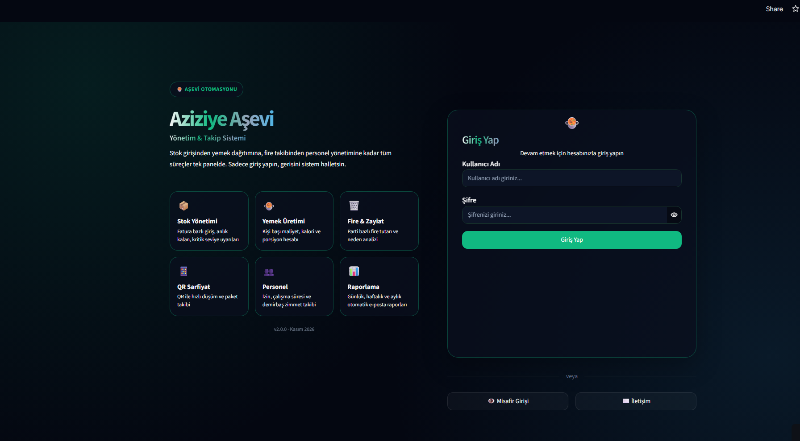
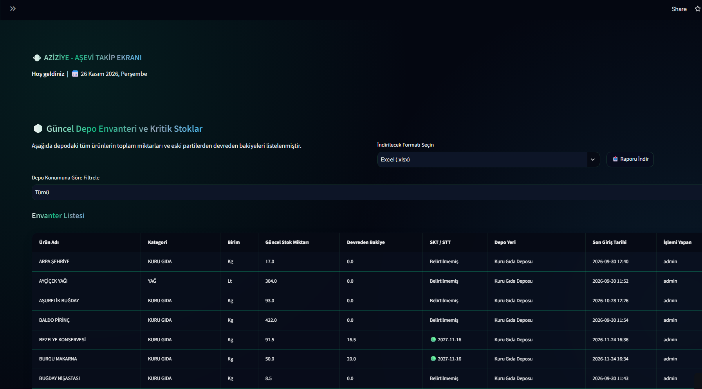

<div align="center">

# 🍲 Aziziye Aşevi | Modern Yönetim & Takip Sistemi

**Aşevi operasyonlarını tek bir merkezden, güvenli, hızlı ve modern bir şekilde yönetin.**

[](https://www.python.org/)
[](https://streamlit.io/)
[](https://supabase.com/)
[]()

## 📸 Ekran Görüntüleri

<div align="center">
  
  <p><i>Kurumsal Dashboard & Operasyonel Özet</i></p>
  
  
</div>

</div>

---

## 🌟 Proje Hakkında

**Aziziye Aşevi**, bir aşevinin tüm karmaşık operasyonlarını (stok girişinden yemek dağıtımına, fire takibinden personel yönetimine kadar) tek bir dijital panelde birleştiren, kurumsal seviyede bir yönetim sistemidir.

Sadece bir arayüz değil; arka planda **veri güvenliğini (Fernet), çakışma önleyici (CAS) veritabanı mimarisini ve %100 test kapsama oranını** barındıran profesyonel bir altyapıdır.

## ✨ Öne Çıkan Özellikler

*   📦 **Akıllı Stok Yönetimi:** Fatura bazlı giriş, SKT (Son Kullanma Tarihi) uyarıları ve kritik seviye takibi.
*   📱 **QR Kod ile Hızlı Sarfiyat:** Paketli ürünlerde stok düşümünü QR kod okutarak saniyeler içinde gerçekleştirin.
*   🍲 **Gelişmiş Yemek Üretimi:** Kişi başı maliyet, kalori hesabı ve geçmiş üretim verilerine dayalı "akıllı tüketim" uyarıları.
*   🗑️ **Fire ve Zayiat Analizi:** Fatura ve birim fiyat bazlı, neden analizli detaylı fire takibi.
*   👥 **Personel ve İhtiyaç Sahibi Takibi:** Personel izinleri, çalışma süreleri ve ihtiyaç sahiplerinin hassas verilerinin **uçtan uca şifrelenerek** saklanması.
*   📊 **Dashboard & Raporlama:** Plotly destekli interaktif grafikler ve otomatik e-posta raporlama sistemi.
*   📖 **Hazır Reçeteler & Haftalık Menü Planlama:** Standart porsiyon reçeteleri ve haftalık menüye göre otomatik satın alma ihtiyaç listesi.
*   🚚 **Araç Sefer & Rota Teslimat Takibi:** Sıcak yemek dağıtım araçlarının sefer/km kayıtları ve mahalle bazlı teslimat teyit fişleri.
*   🏢 **Tedarikçi Rehberi & Demirbaş Yönetimi:** Tedarikçi alım/fiyat kıyaslaması, çoklu depo ve mutfak demirbaş zimmet takibi.
*   🛡️ **Denetim İzi (Audit Log) & Sabah Brifingi:** İşlem geçmişi, önceki/sonraki değer karşılaştırmalı geri alma ve otomatik kritik uyarı merkezi.
*   🧩 **Kod Yazmadan Sayfa Düzenleyici:** Menü gruplarını, sayfa başlıklarını yönetme ve özel duyuru/bilgi sayfaları oluşturma.

## 🔒 Güvenlik ve Mimari

Bu proje, canlı ortamda uzun yıllar sorunsuz çalışması için en üst düzey güvenlik ve mimari standartlarla geliştirilmiştir:

*   **Uçtan Uca Şifreleme:** TC Kimlik No, telefon ve adres gibi hassas veriler veritabanına yazılmadan önce `Cryptography (Fernet)` ile şifrelenir.
*   **Optimistic Concurrency Control (CAS):** Aynı anda birden fazla kullanıcının veri girmesi durumunda veri kaybını önleyen versiyonlama (Compare-And-Swap) sistemi.
*   **Modüler Yapı:** Devasa tek dosyalar yerine (Single Responsibility) görevine göre ayrılmış, bakımı kolay modüller.
*   **Kurtarma Anahtarı (Master Key):** Yönetici şifresinin unutulması durumunda `secrets.toml` üzerinden güvenli geçici şifre üretimi.
*   **Giriş Güvenliği:** Brute-force (şifre deneme) saldırılarına karşı IP bazlı ve kullanıcı bazlı otomatik kilitlenme (Rate Limiting) mekanizması.

---

## 🏗️ Proje Mimarisi (Dosya Yapısı)

```text
aziziye-asevi/
├── app.py                      # Streamlit giriş noktası
├── requirements.txt            # Bağımlılıklar
├── .streamlit/
│   └── secrets.toml            # Çevre değişkenleri (Gizli anahtarlar)
├── assets/                     # README ekran görüntüleri
│   ├── dashboard.png
│   ├── giris.png
│   └── stok.png
├── src/
│   ├── app_runtime.py          # Ana orkestra şefi (Sayfa yönlendirmeleri)
│   ├── supabase_db.py          # Veritabanı bağlantısı ve CAS işlemleri
│   ├── auth_session.py         # Oturum yönetimi ve giriş güvenliği
│   ├── cekirdek.py             # Şifreleme ve temel iş kuralları
│   ├── veri_yonetimi.py        # Standart veri okuma/yazma işlemleri
│   ├── kullanici_yonetimi.py   # Şifreli kullanıcı/personel işlemleri
│   ├── yemek_utils.py          # Fire, QR ve kalori hesaplamaları
│   ├── sistem_yardimcilari.py  # E-posta, resim işleme, tarih araçları
│   ├── ui_styles.py            # CSS ve tema tasarımları
│   └── [sayfa]_ui.py           # Sayfalara özel arayüz dosyaları
└── tests/                      # 104 adet kapsamlı birim testi (pytest)

Bu proje Apache License 2.0 ile lisanslanmıştır.

Copyright 2026 Sefa Ünal Topcu (Aziziye Aşevi adına)
