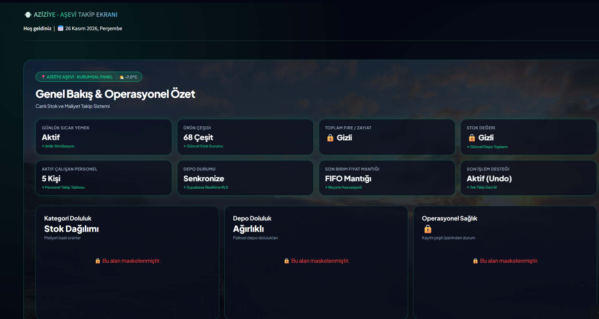

<div align="center">

# 🍲 Aziziye Aşevi (`sefaasevi`) | Modern Yönetim & Takip Sistemi

**Aşevi operasyonlarını tek bir merkezden, güvenli, hızlı ve modern bir şekilde yönetin.**

[](https://www.python.org/)
[](https://streamlit.io/)
[](https://supabase.com/)
[]()

## 📸 Ekran Görüntüleri

<div align="center">
  
  <p><i>Kurumsal Dashboard & Operasyonel Özet</i></p>
  
  
</div>

</div>

---

## 🌟 Proje Hakkında

**Aziziye Aşevi (`sefaasevi`)**, bir aşevinin tüm karmaşık operasyonlarını (stok girişinden yemek üretimine, haftalık menü ve reçete planlamasından mahalle bazlı sıcak yemek teslimatına, fire analizinden personel yönetimine kadar) tek bir dijital panelde birleştiren kurumsal seviyede bir yönetim sistemidir.

Sadece bir arayüz değil; arka planda **veri güvenliğini (Fernet), çakışma önleyici (CAS) veritabanı mimarisini, tam denetim izini (Audit Log) ve 141 adet birim testini** barındıran profesyonel bir altyapıdır.

---

## ✨ Öne Çıkan Özellikler

*   📦 **Akıllı Depo & Stok Yönetimi:** Fatura ve bağış bazlı giriş, ağırlıklı ortalama birim maliyet hesabı, SKT/STT uyarıları, kritik seviye takibi, çoklu depo ve demirbaş zimmet yönetimi.
*   📱 **QR Kod ile Hızlı Sarfiyat:** Paketli ürünler için yazdırılabilir QR etiketleri üretme ve kamera/okuyucu ile saniyeler içinde stoktan düşüm yapma.
*   🍲 **Gelişmiş Yemek Üretimi & Maliyet Analizi:** Porsiyon başı maliyet, kalori/besin değeri hesabı ve geçmiş üretim ortalamalarına dayalı "akıllı sapma" uyarıları.
*   📖 **Hazır Yemek Reçeteleri & Haftalık Menü Planlama:** Standart porsiyon reçetelerini kişi sayısına göre otomatik ölçekleme ve haftalık menüye göre depodaki stoğu düşerek otomatik satın alma ihtiyaç listesi oluşturma.
*   🚚 **Araç Sefer & Rota Teslimat Takibi:** Sıcak yemek dağıtım araçlarının çıkış/dönüş kilometre ve belge (muayene/sigorta) takibi ile mahalle/hanehalkı bazlı teslimat teyit fişleri.
*   🗑️ **Fire, Zayiat & İade Analizi:** Fatura ve birim fiyat bazlı, neden analizli detaylı fire ve tedarikçi iade takibi.
*   🏢 **Tedarikçi ve Firma Rehberi:** Firma kartları, tedarikçi bazlı alım hacmi ve dönemlik birim fiyat değişim analizleri.
*   👥 **Personel ve İhtiyaç Sahibi Takibi:** Resmi tatil ve hafta sonlarını otomatik düşen net fiili çalışma günü raporu ile ihtiyaç sahiplerinin hassas verilerinin **uçtan uca şifrelenerek** saklanması.
*   🛡️ **Denetim İzi (Audit Log) & Sabah Brifingi:** Tüm veri değişikliklerini önceki/sonraki değerleriyle izleme, geri alma ve kritik stok/SKT/belge uyarılarını tarayan otomatik Sabah Brifingi merkezi.
*   🧩 **Kod Yazmadan Sayfa Düzenleyici & Test Temizliği:** Admin panelinden menü sıralama, başlık özelleştirme, özel bilgilendirme sayfası oluşturma ve test kayıtlarını ilgili stoğu otomatik iade ederek tek tıkla silme.
*   📊 **Dashboard & Otomatik Raporlama:** Plotly destekli interaktif grafikler, Excel/PDF dışa aktarım ve zamanlanmış/manuel SMTP e-posta raporlama sistemi.

---

## 🧭 Uygulama Sayfa Haritası (23 Yerleşik Modül)

| Menü Grubu | Sayfalar | Temel İşlev |
| :--- | :--- | :--- |
| **🏠 Genel Bakış** | Kurumsal Dashboard & Özet | Anlık stok değeri, kritik/SKT uyarıları, üretim maliyetleri ve dağıtım grafikleri. |
| **📦 Depo & Stok Yönetimi** | Güncel Stok Durumu, Yeni Mal Alımı / Fatura Ekle, QR Kod ile Hızlı Sarfiyat, Ürün Sil / Düzenle, Fire / Zayiat Girişi, Toplu Stok Düşümü & Sarfiyat, Ürün Birim Fiyatları & Ay Analizi, Depo Yönetimi, Demirbaş Yönetimi, Tedarikçi ve Firma Rehberi | Stok giriş-çıkış, ağırlıklı ortalama maliyet, QR etiketleme, fire/iade, çoklu depo, demirbaş ve tedarikçi yönetimi. |
| **🍲 Üretim & Mutfak** | Günlük Yemek Üretimi & Maliyet Raporu, Hazır Yemek Reçeteleri, Haftalık Menü Planlama, Kalori Hesaplama Aracı | Reçete ölçekleme, haftalık menüden otomatik satın alma listesi, üretim sapma kontrolü ve kalori/besin analizi. |
| **👥 Sosyal & İnsan Kaynakları** | İhtiyaç Sahibi & Yemek Dağıtım Takibi, Sıcak Yemek Dağıtım Araç ve Sefer Takibi, Rota & Teslimat Takibi, Personel & Çalışma Süresi Takibi | Şifreli vatandaş kayıtları, toplu dağıtım sayaçları, araç sefer/km kayıtları, mahalle rota teslimatı ve net iş günü hesabı. |
| **📈 Raporlama & Analiz** | Kullanım Takibi, Denetim İzi (Audit Log), Kritik Uyarı Merkezi & Sabah Brifingi, Kapsamlı Envanter ve Hareket Raporu | Hareket dökümleri, önceki/sonraki değer karşılaştırmalı geri alma, sabah brifingi uyarıları ve resmi envanter cetveli. |
| **⚙️ Sistem Ayarları** | Kullanıcı Ayarları *(Yalnızca Admin)* | Rol/sayfa maskeleme, giriş kayıtları, tam JSON yedekleme, manuel mail raporu, sayfa bazlı test verisi silme ve kod yazmadan sayfa düzenleyici. |

---

## 🔒 Güvenlik ve Mimari

Bu proje, canlı ortamda uzun yıllar sorunsuz çalışması için en üst düzey güvenlik ve mimari standartlarla geliştirilmiştir:

*   **Uçtan Uca Şifreleme:** TC Kimlik No, telefon ve adres gibi hassas veriler veritabanına yazılmadan önce `Cryptography (Fernet)` ile şifrelenir.
*   **Optimistic Concurrency Control (CAS):** Aynı anda birden fazla kullanıcının veri girmesi durumunda veri kaybını önleyen versiyonlama (Compare-And-Swap) sistemi.
*   **Modüler Yapı:** Görevine göre ayrılmış UI (`*_ui.py`), veritabanı (`*_sql.py`) ve iş mantığı modülleri.
*   **Kurtarma Anahtarı (Master Key):** Yönetici şifresinin unutulması durumunda `secrets.toml` üzerinden güvenli geçici şifre üretimi.
*   **Giriş Güvenliği:** Brute-force saldırılarına karşı IP ve kullanıcı bazlı otomatik kilitlenme (Rate Limiting) mekanizması.

---

## 🏗️ Proje Mimarisi (Dosya Yapısı)

```text
sefaasevi/
├── app.py                          # Streamlit giriş noktası
├── requirements.txt                # Runtime ve test bağımlılıkları
├── .streamlit/
│   ├── config.toml                 # Koyu tema (#040711) ve sunucu ayarları
│   └── secrets.toml                # Çevre değişkenleri (Gizli anahtarlar - Git hariç)
├── assets/                         # README ekran görüntüleri
│   ├── dashboard.png
│   ├── giris.png
│   └── stok.png
├── src/
│   ├── app_runtime.py              # Ana orkestra şefi (Sayfa yönlendirmeleri ve yetki kontrolü)
│   ├── supabase_db.py              # Veritabanı bağlantısı ve CAS işlemleri
│   ├── auth_session.py             # Oturum yönetimi ve giriş güvenliği
│   ├── cekirdek.py                 # Fernet şifreleme ve temel iş kuralları
│   ├── veri_yonetimi.py            # Standart veri okuma/yazma işlemleri
│   ├── kullanici_yonetimi.py       # Şifreli kullanıcı/personel işlemleri
│   ├── yemek_utils.py              # Fire, QR ve kalori hesaplamaları
│   ├── sistem_yardimcilari.py      # E-posta, resim işleme, tarih araçları
│   ├── ui_styles.py & tema_ui.py   # Koyu tema CSS ve kart bileşenleri
│   ├── *_sql.py                    # Supabase tablo ve sorgu katmanları
│   └── *_ui.py                     # Sayfalara özel modüler arayüz dosyaları
└── tests/                          # 20 test dosyasında 141 adet birim testi (pytest)

Bu proje Apache License 2.0 ile lisanslanmıştır.

Copyright 2026 Sefa Ünal Topcu (Aziziye Aşevi adına)
